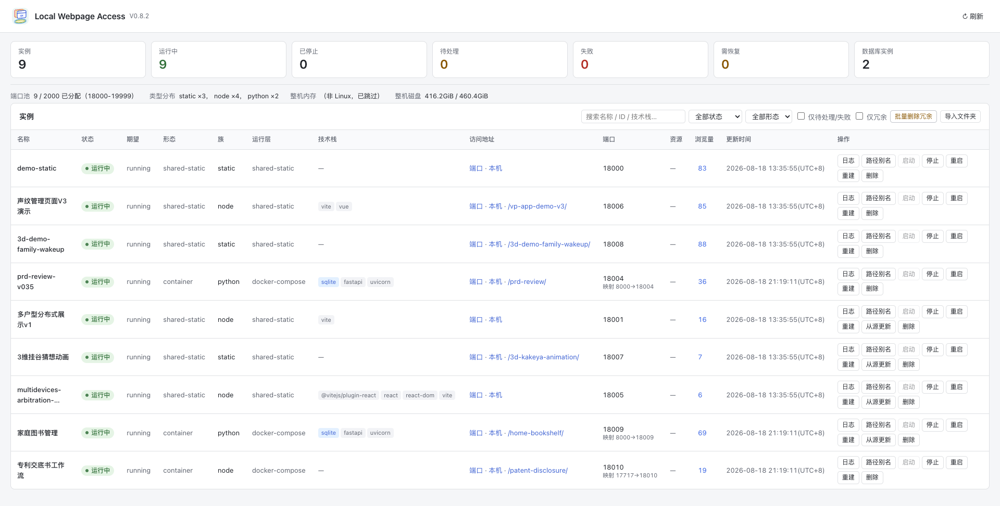

<a id="english"></a>
<h1>
  
  Local Webpage Access (<code>lwa</code>)
</h1>

**Deploy local web projects to your LAN.**

Import a zip, a local folder, or a GitHub repository. LWA detects the project, prepares its runtime, assigns a port, and gives you a LAN URL. Designed for home servers, personal tools, and demos on 4–8 GB hosts; resource needs depend on the application.

**English** · [中文](#中文文档)

[Projects](#supported-projects) · [Features](#features) · [Quick start](#quick-start) · [Documentation](#documentation)



## Supported projects

| Project | How LWA runs it |
| --- | --- |
| Static HTML | Serve through Caddy or the built-in static server |
| Frontend projects such as Vite, React, Vue, Svelte, and Astro | Install dependencies, build, and serve the output |
| Node.js / Python backends and SQLite full-stack apps | Generate a Dockerfile and Compose configuration, then run in containers |

Projects LWA cannot identify remain `pending` until you confirm or correct their configuration. Backend hosting requires Docker; network databases and complex multi-service deployments need project-specific setup. See [supported layouts and limits](docs/known-limitations.md).

## Features

- **Import and update in place.** Copy from zip, folder, or GitHub sources without running inside your original source tree. Updates retain the instance ID, registered port, alias, and persistent data directory.
- **Choose how to access each app.** Use an individual LAN port or a Caddy path alias such as `/my-tool/`. Optional HTTPS uses Caddy's internal CA and requires clients to trust the CA root certificate.
- **Control builds and releases.** Queue or cancel builds, customize build variables and hooks, and retain container image versions for rollback. Running container rebuilds default to building before stopping the old version, with failure recovery.
- **Keep application data separate.** Managed data mounts preserve files across rebuilds, including detected Flask instance SQLite directories. Container image rollback does not restore database contents.
- **Manage from one place.** Use the CLI or web manager for lifecycle actions, logs, resource usage, pageviews, and operation history. The inbox daemon handles zip imports and recovery; systemd / launchd support autostart.
- **Connect local AI assistants.** Authenticated HTTP APIs and a stdio MCP server support deployment plans, operation tracking, and lifecycle control. Agent access currently requires loopback and a valid token.

## Quick start

### 1. Install LWA

Use **Python 3.13+**. From a local checkout of this repository:

```bash
python3 -m venv .venv
source .venv/bin/activate
python -m pip install -e .
lwa setup
```

`lwa setup` checks host tools and reports missing dependencies. Containers require **Docker 29.0.0+** and **Compose 2.40.2+**; Caddy **2.10.0+** enables path aliases and HTTPS. Frontend builds also need the project's Node.js/package-manager toolchain.

Supported hosts: **Ubuntu LTS 22.04 / 24.04 / 26.04, Debian 12 / 13, Fedora 43 / 44, WSL2 with supported Linux distributions, and macOS 14+**. Native Windows and WSL1 are unsupported. See [platform requirements and WSL2 preparation](docs/known-limitations.md).

### 2. Create a workspace

```bash
lwa init --workspace ~/lwa-workspace
cd ~/lwa-workspace
```

The workspace holds imported projects, configuration, data, and logs. Keep it on the Linux filesystem when using WSL2. For automated Docker/Caddy installation and readiness checks, run `lwa setup --full --yes` inside this initialized workspace; see the [setup guide](docs/operations-playbook.md).

### 3. Import and start a project

```bash
lwa import /absolute/path/my-site.zip --name my-site
lwa start my-site
lwa status my-site
```

Replace the zip path with your file. Use the instance ID printed by import if it differs from `my-site`. Open the LAN URL printed by `lwa start` from another device on the same LAN; firewall and WSL2 networking guidance is in the [access checklist](docs/known-limitations.md#lan-访问与防火墙).

Other import sources:

```bash
lwa import --from-dir /absolute/path/my-project
lwa import --from-git https://github.com/owner/repo
```

### 4. Open the web manager

```bash
lwa manager on
```

With default HTTP settings, open **http://127.0.0.1:17800/** on the host. LAN access requires the current token, available through `lwa manager token`. See [manager access and authentication](docs/manager-page.md).

## Everyday operations

Run these inside the workspace, or prefix a command with `lwa --workspace /absolute/path/to/workspace`.

| Task | Command |
| --- | --- |
| List apps / inspect one app | `lwa list` / `lwa status my-site` |
| Stop / start / restart | `lwa stop my-site` / `lwa start my-site` / `lwa restart my-site` |
| Update a zip-based app | `lwa import /absolute/path/new.zip --update my-site` |
| Sync a linked folder/GitHub source and rebuild | `lwa rebuild my-site --sync` |
| Read logs / diagnose problems | `lwa logs my-site` / `lwa doctor my-site` |
| Review retained container versions / roll back | `lwa versions my-site` / `lwa rollback my-site` |
| Watch the workspace inbox / install autostart | `lwa daemon on` / `lwa autostart install` |

Use `lwa <command> --help` for options. The [CLI reference](docs/cli-reference.md) covers aliases, instance settings, probes, gateway control, workspace moves, and LWA updates.

## Configuration and boundaries

Workspace settings live in `local-web.yml`; per-app settings live in `apps/<id>/local-web.json` and can be managed with `lwa configure`. Store databases and uploads in persistent mounts: files elsewhere in a container can disappear when it is replaced. See [workspace and data layout](docs/runtime-workspace.md).

Only deploy projects you trust. Import checks and generated Docker/Compose audits catch risky patterns; they are not a sandbox for untrusted code. LWA targets LAN use; public hosting and remote Agent access are outside the current scope. See [security boundaries](docs/security-boundary.md) and [HTTPS setup](docs/https.md).

## Documentation

| Topic | Guide |
| --- | --- |
| Commands and instance configuration | [CLI reference](docs/cli-reference.md) |
| Setup and daily operation | [Operations playbook](docs/operations-playbook.md) · [Autostart](docs/autostart.md) |
| Troubleshooting and supported deployments | [FAQ](docs/faq.md) · [Known limitations](docs/known-limitations.md) |
| Workspace, data, and relocation | [Workspace layout](docs/runtime-workspace.md) · [Relocation](docs/workspace-rename.md) |
| Manager and AI assistants | [Manager/API](docs/manager-page.md) · [Agent/MCP guide](docs/agent-guide.md) · [Skills](src/local_webpage_access/skills/README.md) |
| Access protection | [Security boundaries](docs/security-boundary.md) · [HTTPS](docs/https.md) |
| Testing and release | [Testing](docs/testing.md) · [Release checklist](docs/release-checklist.md) · [Acceptance checklist](docs/acceptance-checklist.md) |

## Development

From the repository root, with the virtual environment active:

```bash
python -m pip install -e ".[dev,mcp]"
bash tests/gate.sh
```

Code lives in `src/local_webpage_access/`, tests in `tests/`. Real Docker integration tests require `LWA_RUN_DOCKER_TESTS=1`; see [testing](docs/testing.md). Maintainer work is tracked in [task-list.md](task-list.md).

## License

[MIT](LICENSE).

---

# 中文文档

**把本地网页项目部署到局域网。**

导入 zip、本机文件夹或 GitHub 仓库，LWA 自动识别项目、准备运行环境、分配端口，并提供局域网访问地址。适合 4–8 GB 家庭服务器上的个人工具和演示项目，实际资源需求取决于应用。

[English](#english) · **中文**

[支持的项目](#支持的项目) · [核心功能](#核心功能) · [快速开始](#快速开始) · [文档导航](#文档导航)


## 支持的项目

| 项目类型 | 托管方式 |
| --- | --- |
| 纯静态 HTML | 通过 Caddy 或内置静态服务直接托管 |
| Vite、React、Vue、Svelte、Astro 等前端项目 | 安装依赖、构建，再托管产物 |
| Node.js / Python 后端、含 SQLite 的全栈应用 | 自动生成 Dockerfile 与 Compose 配置，在容器中运行 |

无法识别的项目保持 `pending`，需要确认或修正配置后再启动。后端托管依赖 Docker；网络数据库和复杂多服务部署需要按项目配置。详见[项目布局与限制](docs/known-limitations.md)。

## 核心功能

- **导入与原地更新。** 支持 zip、文件夹和 GitHub 源，复制到工作区运行，不在原始源码目录中就地部署。更新保留实例 ID、登记端口、别名和持久化数据目录。
- **灵活访问。** 每个应用可使用独立局域网端口，也可通过 Caddy 使用 `/my-tool/` 形式的路径别名。可选 HTTPS 使用 Caddy 内部 CA，客户端需要信任 CA 根证书。
- **构建与版本管理。** 支持构建排队、取消、自定义构建变量和钩子，以及容器镜像留档与回滚。运行中的容器默认先构建再停旧版本，并提供失败恢复。
- **应用数据独立保存。** 托管数据挂载在重建时保留文件，也覆盖识别到的 Flask instance SQLite 目录。容器镜像回滚不会回退数据库内容。
- **集中管理与运维。** CLI 和管理页提供启停、日志、资源、浏览量与操作历史。inbox 守护进程负责 zip 自动导入与恢复，支持 systemd / launchd 开机自启。
- **本机 AI 助手接入。** 通过鉴权 HTTP API 和 stdio MCP 服务创建部署计划、跟踪操作、管理实例生命周期。当前 Agent 通道仅允许本机回环访问，并要求有效 token。

## 快速开始

### 1. 安装 LWA

需要 **Python 3.13+**。在已克隆的本仓库根目录运行：

```bash
python3 -m venv .venv
source .venv/bin/activate
python -m pip install -e .
lwa setup
```

`lwa setup` 检测宿主工具并提示缺失依赖。容器需要 **Docker 29.0.0+**、**Compose 2.40.2+**；路径别名与 HTTPS 需要 **Caddy 2.10.0+**。前端构建还需要项目对应的 Node.js 和包管理器工具链。

支持 **Ubuntu LTS 22.04 / 24.04 / 26.04、Debian 12 / 13、Fedora 43 / 44、运行受支持 Linux 发行版的 WSL2，以及 macOS 14+**。不支持 Windows 原生进程和 WSL1。详见[平台要求与 WSL2 准备](docs/known-limitations.md)。

### 2. 创建工作区

```bash
lwa init --workspace ~/lwa-workspace
cd ~/lwa-workspace
```

工作区保存导入的项目、配置、数据和日志。WSL2 下请放在 Linux 文件系统。若需自动安装 Docker/Caddy 并检查运行能力，在这个已初始化的工作区执行 `lwa setup --full --yes`；详见[装配指南](docs/operations-playbook.md)。

### 3. 导入并启动项目

```bash
lwa import /absolute/path/my-site.zip --name my-site
lwa start my-site
lwa status my-site
```

把 zip 路径换成实际文件。若导入结果中的实例 ID 不是 `my-site`，后续命令使用实际 ID。在同一局域网的其他设备打开 `lwa start` 输出的局域网地址；防火墙与 WSL2 网络配置见[访问检查说明](docs/known-limitations.md#lan-访问与防火墙)。

也可从其他来源导入：

```bash
lwa import --from-dir /absolute/path/my-project
lwa import --from-git https://github.com/owner/repo
```

### 4. 打开管理页

```bash
lwa manager on
```

默认 HTTP 配置下，在主机打开 **http://127.0.0.1:17800/**。局域网访问需要当前 token，可执行 `lwa manager token` 查看。详见[管理页访问与鉴权](docs/manager-page.md)。

## 常用操作

在工作区内执行以下命令；也可在命令前使用 `lwa --workspace /absolute/path/to/workspace` 指定工作区。

| 任务 | 命令 |
| --- | --- |
| 列出应用 / 查看单个应用 | `lwa list` / `lwa status my-site` |
| 停止 / 启动 / 重启 | `lwa stop my-site` / `lwa start my-site` / `lwa restart my-site` |
| 更新 zip 源应用 | `lwa import /absolute/path/new.zip --update my-site` |
| 同步关联文件夹或 GitHub 源并重建 | `lwa rebuild my-site --sync` |
| 查看日志 / 诊断问题 | `lwa logs my-site` / `lwa doctor my-site` |
| 查看留档容器版本 / 回滚 | `lwa versions my-site` / `lwa rollback my-site` |
| 监听工作区 inbox / 安装自启 | `lwa daemon on` / `lwa autostart install` |

选项说明使用 `lwa <command> --help` 查询。[命令参考](docs/cli-reference.md)覆盖别名、实例配置、探针、网关、工作区迁移和 LWA 自身升级。

## 配置与边界

工作区配置保存在 `local-web.yml`；应用配置保存在 `apps/<id>/local-web.json`，可通过 `lwa configure` 管理。数据库和上传文件应放入持久化挂载，容器内其他位置的文件可能在替换容器时丢失。详见[工作区与数据布局](docs/runtime-workspace.md)。

请只部署可信项目。导入检查和 Docker/Compose 生成审计用于拦截高危模式，不是运行不可信代码的沙箱。LWA 面向局域网使用，公网托管与远程 Agent 接入不在当前范围内。详见[安全边界](docs/security-boundary.md)与 [HTTPS 配置](docs/https.md)。

## 文档导航

| 主题 | 文档 |
| --- | --- |
| 命令与实例配置 | [命令参考](docs/cli-reference.md) |
| 装配与日常运维 | [运维手册](docs/operations-playbook.md) · [开机自启](docs/autostart.md) |
| 排障与部署范围 | [FAQ](docs/faq.md) · [已知限制](docs/known-limitations.md) |
| 工作区、数据与迁移 | [工作区布局](docs/runtime-workspace.md) · [迁移手册](docs/workspace-rename.md) |
| 管理页与 AI 助手 | [管理页/API](docs/manager-page.md) · [Agent/MCP 指南](docs/agent-guide.md) · [Skills](src/local_webpage_access/skills/README.md) |
| 访问保护 | [安全边界](docs/security-boundary.md) · [HTTPS](docs/https.md) |
| 测试与发布 | [测试指南](docs/testing.md) · [发布检查](docs/release-checklist.md) · [验收检查](docs/acceptance-checklist.md) |

## 开发

在仓库根目录、已激活虚拟环境的终端运行：

```bash
python -m pip install -e ".[dev,mcp]"
bash tests/gate.sh
```

代码位于 `src/local_webpage_access/`，测试位于 `tests/`。真实 Docker 集成测试需设置 `LWA_RUN_DOCKER_TESTS=1`，详见[测试指南](docs/testing.md)。维护工作记录在 [task-list.md](task-list.md)。

## 许可

[MIT](LICENSE)。
