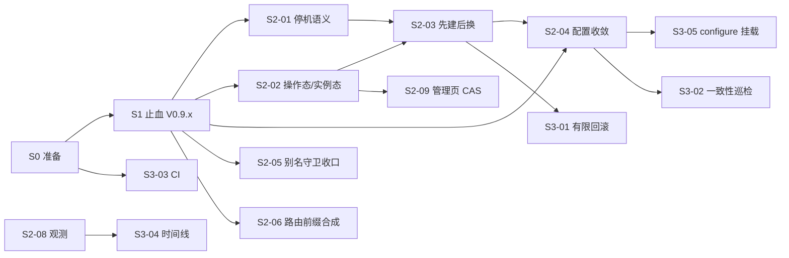

# LWA 下一阶段计划：问题修复与重点功能（V0.9.x 止血 → V0.10.0 收敛 → V0.10.x 功能）

> 编制：2026-10-11 22:52（+08）。基线：HEAD `d757384`（V0.9.1-Build4310），工作区有未提交的 V0.9.2 版本号与文档变更（[[OPS-197]] [[DOC-187]]）。
> 输入：GitHub issue #47–#60；`design/5-reviews/` 下 2026-10-11 的四份评审（`issues-47-60-review`、`issues47-60-evidence-review`、`issues47-60-独立复核与新发现`、`lwa安装使用记录20260717-逐项评审`）及两份复现脚本；task-list 未完成项（CHK-285、DEV-145~148、PLN-031/032/033/044）。
> 读者：维护者与执行 Agent。本文是阶段计划与 WBS。每个工作包开工时，再按 TDD 拆成逐步实施清单（同样放在 `design/3-plans/`）。

## 1. 目标与原则

### 1.1 一句话目标

让 LWA 在“改配置、重建、迁移、设别名”这四类高频操作上做到三件事：**失败时不破坏正在服务的旧版本**、**结果如实可见**、**配置改了就真的生效**。在这个基础上，交付有限回滚和一致性巡检两项重点功能。

### 1.2 问题主题（14 条 issue + 6 项新发现归并后）

| 主题 | 涉及条目 | 用户可见症状 |
| --- | --- | --- |
| A 失败破坏旧服务 / 状态失真 | #51 #53 #54 #57-2 N3 N6 N7 | 构建失败即断服；迁移时容器没停也继续搬；restart 没停掉却报“已重启”；旧容器在跑却显示 FAILED |
| B 配置变更不生效 | #47 #48 #57-1 N4 | 新前端没上线；extraVolumes 改了 restart 不生效；手改 compose 不经审计就被应用 |
| C 别名守卫误报与漏报 | #49 #52 #58 N1 N5 | CDN 页面被误判失败；白屏但命令成功、doctor 全绿；无斜杠地址打开是白屏；纯 API 服务别名必失败 |
| D 边界与不确定性 | #50 #55 #56 #59 N2 sudo | 健康端点发现不了，或被 SPA 页冒充通过；systemd 卡死时 CLI 永久挂起；“判不了”被当成通过或冲突；日志看不全 |
| E 工程门禁 | #60 P-1 | 没有 CI；Caddy 配置测试只比对字符串 |

### 1.3 执行原则

1. **先止血，后重构。** 一行到一天能修完、且不改核心流程的缺陷先发补丁版；涉及 lifecycle/hosting 主流程的改动集中到 V0.10.0，统一设计、统一回归。
2. **先修误报，再收紧失败。** 别名组按“URL 分类（#49）→ 采样覆盖（#58）→ 失败硬化（#52）”的顺序推进；健康探针按“内容校验（N2）→ 放宽深度（#50）”推进。顺序反过来会把误报升级成阻断，或把诚实降级变成假绿。
3. **旧版本是最后一道防线。** 重建、recreate、迁移在确认新版本可用之前，不得销毁仍在服务的旧容器；必须先停时，停机失败就中止。
4. **操作态和实例态分开记录。** “这次重建失败”不等于“实例坏了”。实例状态只反映实际观测结果，操作结果另行记录并展示。
5. **每个修复都把复现转为回归。** `design/5-reviews/` 两份复现脚本里“断言缺陷存在”的用例，在修复时翻转断言，迁入 `tests/`。
6. **文档随行为同步。** FAQ、operations-playbook、manager-page、agent-guide 中与本次行为变化相关的段落，与代码在同一工作包内修改。

### 1.4 范围外（本阶段明确不做）

| 事项 | 理由 | 何时重议 |
| --- | --- | --- |
| Agent M2（LAN 通道、制品上传） | 依赖本阶段的 revision/CAS 与操作态模型，先做会返工 | V0.10.0 发布后 |
| generated-static（PLN-049） | 新运行形态，扩大状态面；本阶段目标是收敛 | V0.11 |
| LAN 加固 H2/H3（PLN-051） | 与本阶段无直接依赖，避免并行改 manager 鉴权 | V0.11 |
| IMP-048/049/050、IMP-029（PLN-031/032/033/044） | 维持“需求触发后重新论证” | 不变 |
| DEV-145/147/148（源健康度、takeover、代理诊断） | 与 issue #36 已关闭后的增强项相关，不在本阶段主题内 | V0.11 |
| 全量长函数重构（#60 第 7 点） | 只在本阶段改动到的函数上顺手拆分（S3-06），不做专项重构 | — |

DEV-146（apt 总体时间预算）与主题 D 同类，作为可选项放进 S3 的缓冲区，人力有余时再做。

## 2. 决策（已确认）

以下 8 项已于 2026-10-11 由维护者确认，**全部采用“推荐”列**，执行时按推荐值落实。

| ID | 决策点 | 选项 | 推荐 | 理由 |
| --- | --- | --- | --- | --- |
| D1 | manifest 中影响镜像的字段（buildEnv/buildHooks/preStart/systemDeps）变化后，`start`/`restart` 怎么处理 | a 自动走 full rebuild（与现有 sourceHash 变化策略一致）；b 只告警“待 rebuild 生效” | **a**，restart 与 start 走同一判定 | 现有指纹机制对源码变化已经自动重建，再给配置字段开例外，只会制造新的“改了不生效” |
| D2 | 更新/重建后别名活验证失败（内容级）时的退出码 | a 退出码 1；b 新增 4，表示“部分成功：内容已更新、别名验证失败”；c 维持 0 | **b**，同时提供 `--ignore-alias-guard` 豁免（记审计事件） | 1 无法区分“没更新”和“更新了但别名坏”；脚本需要区分这两者 |
| D3 | `import --update` 未显式传 `--path-alias`、但实例已有别名，新源码含绝对资源时 | a 换入前拒绝更新；b 照常更新，事后告警 | **a**，拒绝文案给出补救命令；`--ignore-alias-guard` 可覆盖 | 符合 BUG-469“导入期与运行时过同一道守卫”；拒绝发生在换入之前，零副作用 |
| D4 | 重建失败（build/up/验证失败）后，旧容器仍在服务时的实例状态 | a 保持 RUNNING，`lastOperation=failed` 并展示；b 标 FAILED | **a** | 状态反映实际服务；失败信息走操作记录，UI 显示“运行中 · 最近一次重建失败” |
| D5 | 低内存主机上“先建后换”的资源压力 | a 全局默认 swap，实例可设 `rebuildStrategy: stop-first`；b 一律 swap | **a** | 构建期间新旧两份同时占内存，小主机需要逃生口 |
| D6 | 迁移前停机失败 | a 中止迁移，保持 QUIESCE 失败态，修复后 `--resume`；b 继续迁移 | **a**，另提供 `--force-quiesce` 显式覆盖 | 停机失败时继续 rename 有数据风险 |
| D7 | 纯 API 服务（契约 `servesUi=false`）设别名后的活验证 | a 入口返回任意非 5xx 即通过，跳过 HTML 与资源探针；b 维持要求 HTML | **a**，结果记为 `passed(api-only)` | 现状是这类服务设别名后验证必然失败 |
| D8 | 回滚范围 | a 只回滚镜像与生成配置，不动 data/数据库；b 连同数据快照 | **a**；`preStart` 含迁移命令时回滚需 `--yes` 并醒目告警 | 数据回滚涉及应用语义，LWA 无法保证正确性 |

## 3. 里程碑与版本

| 里程碑 | 版本 | 主题 | 估算（人日） | 进入条件 | 退出条件 |
| --- | --- | --- | --- | --- | --- |
| S0 准备 | — | 立项、门禁基线、issue 回复 | 1.0 | 本计划确认 | 台账立项完成；`tests/gate.sh` 可用 |
| S1 止血 | V0.9.2（若尚未提交）或 V0.9.3 | 低风险缺陷与文档纠错 | 6.0 | S0 | 门禁全绿；本机 runtime 工作区实测 9 项验收通过 |
| S2 收敛 | V0.10.0 | 失败语义、状态收敛、别名守卫收口 | 18.5 | S1 发布 | 门禁全绿；真实 Docker 用例通过；故障演练 6 项通过 |
| S3 功能 | V0.10.1～V0.10.2 | 有限回滚、一致性巡检、CI、时间线 | 11.5 | S2 中 S2-02/S2-03 完成 | 各功能验收通过 |
| S4 发布验收 | 随 V0.10.0 / V0.10.x | 文档、真机验收、关闭 issue | 2.5 | 各版本代码冻结 | 发布清单完成 |
| **合计** | | | **39.5** | | |

估算按“Agent 执行 + 人工评审”的节奏折算，包含测试与文档，不含排队等待。S3 的 F1（有限回滚）可以在 S2-03 完成后与 S2 后半段并行。

## 4. WBS 总表

优先级：P1 = 会造成断服、更新无效或入口损坏；P2 = 验证、诊断或条件性缺口；P3 = 体验与口径问题。

| WBS | 工作包 | 关联 | 优先级 | 估算 | 依赖 |
| --- | --- | --- | --- | --- | --- |
| **S0-01** | 台账立项：#47～#59 与 N1～N6、N8 登记为 BUG，功能登记为 DEV，建立“issue ↔ 台账 ↔ WBS”映射 | 全部 | — | 0.25 | — |
| **S0-02** | 门禁脚本 `tests/gate.sh`：ruff + pytest（含 Caddy adapt 语义测试，缺 caddy 时跳过）+ `git diff --check` | #60 P-1 | — | 0.5 | — |
| **S0-03** | GitHub issue 回复草稿：收窄 #56-1、#57-4、#58 核心论断、#49 评论中关于 `//` 的说法；建议把 #57 拆成子项（发布前需用户确认） | #49 #56 #57 #58 | — | 0.25 | — |
| **S1-01** | 别名无斜杠 301：改 `redir * /<alias>/ permanent`；全量重写存量别名片段；Caddy adapt 语义测试 | N1 P-1 | P1 | 0.75 | S0-02 |
| **S1-02** | 前端自动构建产物落点按应用根推导 | #47 | P1 | 0.5 | — |
| **S1-03** | 资源引用 URL 分类（`urljoin` + scheme/host 判定），覆盖别名活验证与 API bundle 发现两条调用链 | #49 | P2 | 0.75 | — |
| **S1-04** | 健康探针：响应内容校验（N2）+ 扫描深度放宽 + 零发现告警 + 健康路径命名扩展 | #50（前半）N2 | P2 | 1.0 | — |
| **S1-05** | 迁移停机安全门：去掉吞异常、MOVE 前做后置校验、Gate-C 回滚残留可见 | #53 | P1 | 1.0 | — |
| **S1-06** | 外部命令时间预算：autostart runner 默认超时；安装脚本流式输出 + 总时限 + sudo 预认证 / 非 TTY 提前拒绝 | #55 sudo | P2 | 1.25 | — |
| **S1-07** | 小型可见性修复：status 区分 manifest 缺失/损坏；`_stage` 事件写入失败要告警 | #56-3 #59-2 | P2 | 0.5 | — |
| **S1-08** | 文档纠错：FAQ extraVolumes 与手改 compose 的说法、OPS-200 结论更正、playbook 无斜杠别名 | #48 N1 N4 | P2 | 0.25 | — |
| **S2-01** | 统一停机语义：共享 `stop_or_abort`；重建、漂移修复、restart、recreate、迁移五条路径共用 | #54 N3 | P1 | 1.0 | S1 |
| **S2-02** | 操作态与实例态分离：`lastOperation` 模型；排队超时、构建失败不再把仍在服务的实例标成 FAILED；字段权威来源表 | #57-2 N6 D4 | P1 | 1.5 | S1 |
| **S2-03** | 重建事务化（先建后换）+ 失败补偿；recreate 同步改造；`rebuildStrategy` 逃生口 | #51 近期 N7 D5 | P1 | 3.0 | S2-01 S2-02 |
| **S2-04** | 配置收敛：start/restart/recover 先按 manifest 重渲染生成物（含审计）再做指纹判定；手改生成物会被覆盖并告警 | #48 #57-1 N4 D1 | P1 | 2.0 | S2-03 |
| **S2-05** | 别名守卫收口：故障分类、收口摘要与退出码、更新前守卫、采样覆盖率、doctor 资源检查、管理页展示、纯 API 分支 | #52 #58 N5 D2 D3 D7 | P1 | 3.5 | S1-01 S1-03 |
| **S2-06** | 健康端点路由前缀合成（FastAPI `APIRouter(prefix)` / `include_router(prefix=)`，Node `app.use(prefix, router)`） | #50（后半） | P2 | 1.0 | S1-04 |
| **S2-07** | 显式三态判定：端口归属与 :2019 归属的 `ours/foreign/unknown`，unknown 可见；全库同类判定盘点 | #56-1/2 | P2 | 1.0 | — |
| **S2-08** | 操作观测：阶段日志按触发方镜像到 `lwa.log`（带 `source=`）；静态与前端部署路径补阶段记录 | #59 | P2 | 1.0 | S2-02 |
| **S2-09** | 管理页乐观并发：状态与 API 输出 revision；生命周期接口接受 `expectedRevision`；409 提示刷新 | #57-3 | P2 | 1.5 | S2-02 |
| **S2-10** | Node 内置 `http.createServer` 识别 + monorepo workspace 入口补齐依赖构建、生产模式启动 | N8（OPS-199） | P2 | 1.5 | — |
| **S2-11** | 集成回归与故障演练（真实 Docker 用例 + runtime 工作区演练 6 项） | S2 全部 | — | 1.5 | S2-01～S2-10 |
| **S3-01** | 重点功能 F1：镜像版本留档与有限回滚（`lwa versions` / `lwa rollback`、保留 N 版、GC、管理页版本面板、自愈优先上一可用版本） | #51 远期 D8 | P1 | 4.0 | S2-03 |
| **S3-02** | 重点功能 F2：副本一致性巡检（doctor `state_consistency` + daemon 定期巡检事件） | #57-5 P-2 | P2 | 2.0 | S2-04 |
| **S3-03** | 重点功能 F3：门禁可复现（GitHub Actions 跑 `gate.sh`、mypy 进 dev extras 并按模块逐步纳入、覆盖率基线） | #60 | P2 | 1.5 | S0-02 |
| **S3-04** | 重点功能 F4：操作时间线（API + 管理页抽屉 + `lwa logs --timeline`） | #59 | P2 | 1.5 | S2-08 |
| **S3-05** | `lwa configure --extra-volume` / `--clear-extra-volumes` + settings API | #48 | P3 | 0.75 | S2-04 |
| **S3-06** | 顺手拆分：`host_container` 按阶段拆函数；manager_api 中本阶段改动的路由拆出子模块（行为不变、限时） | #60-7 | P3 | 1.0 | S2 |
| **S3-07** | 缓冲（可选：DEV-146 apt 总体时间预算） | DEV-146 | P3 | 0.75 | — |
| **S4-01** | V0.10.0 发布：版本号、release-checklist、用户文档与内置 skills 同步 | — | — | 1.0 | S2 |
| **S4-02** | CHK-285 一键更新通道真机验收（V0.9.1 → V0.10.0 已满足“落后两个版本”前提） | CHK-285 | — | 0.75 | S4-01 |
| **S4-03** | 逐条关闭 issue（附修复版本与验证证据）；runtime 工作区 13 实例升级演练 | 全部 | — | 0.75 | 各版本 |

## 5. 工作包说明

### S0 准备

**S0-01 台账立项。** 用 task-list CLI 在“代码 Bug”分区追加条目（状态“待修复”），备注写 issue 链接与本 WBS 编号；功能项追加到“功能开发”（状态“待开发”）。对 OPS-200 中“无斜杠访问属网关既有行为”的结论，追加一条检查记录予以更正（台账只追加，不改旧行）。

**S0-02 门禁脚本。** `tests/gate.sh` 依次执行 `ruff check src tests`、`pytest`、`git diff --check`。新增 `tests/scripts/_caddy.py` 辅助函数：PATH 上有 caddy 时对渲染出的 Caddyfile 执行 `caddy adapt`，并返回 JSON 路由供断言；没有 caddy 时 `pytest.skip`。后续所有工作包都以 `gate.sh` 全绿作为完成条件。

**S0-03 issue 回复。** 只准备草稿，不直接发布。要点：#57-4 的 30s 是获取锁的等待上限，持锁期间有心跳续租，建议撤回；#56-1 补充说明 `names is None` 之前已有两道正向证据；#58 说明绝对资源有未截断的硬守卫；#49 说明 `//cdn` 在别名采集中被跳过。建议把 #57 拆成“配置指纹”“写入收敛”“manager CAS”三个子 issue，分别对应 S2-04、S2-02、S2-09。

### S1 止血（V0.9.x 补丁）

**S1-01 别名无斜杠 301（N1）。**
- 修改 `static_gateway.py:577-579`，改为 `redir * /{alias}/ permanent`。
- 把 `gateway_switch.py:405-419` 一带“按 registry 重建别名片段”的循环抽成 `rewrite_alias_fragments(workspace, config)`。在 `lwa update` 收尾和 `lwa gateway on` 时调用；只重写内容与当前模板不一致的片段，然后统一 reload 一次。
- 测试：`tests/test_static_gateway.py:863`、`tests/test_hosting.py:1231` 改为语义断言（adapt 后 `/alias` 路由为 `301`，`Location` 为 `/alias/`）；新增“存量旧片段经 update 收尾后被重写”的用例。
- 验收：在 runtime 工作区执行 `curl -sI http://127.0.0.1:8080/prd-review`，得到 `301`，`Location: /prd-review/`；8443 同样如此。

**S1-02 前端产物落点（#47）。**
- 在 `_frontend_build_block` 中计算后端代码在镜像内的目录：拷贝前缀为 `current//`（展平布局）时为 `/app`；根布局且源码有 `backend/` 目录时为 `/app/backend`；其他情况为 `/app`。产物目标为 `<后端目录>/static`。
- 不默认 `rm -rf` 目标目录（后端可能在 `static/` 中放有自己的文件）；`cp -a dist/.` 会覆盖同名的 `index.html`、`version.json`。构建块里 `echo` 出实际目标，便于从 build.log 中确认。
- `candidate_generator.py:556` 的 `artifactTarget` 用同一规则推导，函数放在一处共用。
- 测试：三种布局（`sourceSubdir=backend`、根布局有 `backend/`、根布局无 `backend/`）断言目标路径；翻转 `issues47-60-repro.py::test_47`。
- 验收：home-bookshelf 实例 rebuild 后，`/app/static/version.json` 与本次构建一致。

**S1-03 URL 分类（#49）。**
- 在 `access.py` 新增 `classify_resource_ref(src, base_url) -> (kind, url_path)`，`kind` 取 `external` / `inline` / `same_origin`。带 scheme 或 netloc（含 `//`）的视为 external；`data:`、`blob:`、`javascript:` 视为 inline；其余用 `urljoin(base_url, src)` 解析出站内路径。
- `_collect_alias_live_probe_paths` 与 `_collect_api_paths` 都改用它；external 先过滤，不占样本名额。`_normalize_script_src` 只保留给仍需要它的调用方，或直接删除。
- 测试：`https://`、`//`、`data:`、相对路径、`../`、带别名前缀的绝对路径、不带前缀的绝对路径、`?query`；4 个 CDN 脚本加 1 个站内 bundle 时，站内 bundle 仍会被抓取。
- 验收：quant-tools-gallery 别名活验证通过，`aliasLiveVerifiedAt` 被写入。

**S1-04 健康探针（N2 + #50 前半）。**
- `_probe_path` 额外返回 Content-Type。declared 或 discovered 探针要作为 API 证据，必须同时满足“状态码达标”和“响应不是 HTML”；如果是 HTML，写入 `probeNotes`：“`<path>` 返回 HTML（疑似 SPA 兜底或缺少路由前缀）”。声明了期望状态码时严格按声明判定，不再“2xx/3xx 一律算过”。
- `_walk_source_files` 深度从 3 放宽到 6，并设文件数上限（例如 3000 个，超出时告警）；遍历结束后，读取 0 个文件或命中 0 条路由时记 WARNING，内容包含 root、深度和读取的文件数。
- `_HEALTH_PATH_RE` 允许带前缀的命名：`public-health`、`healthcheck`、`health-check`。
- 发布说明：少数原本“passed”的实例可能变为“degraded”，这是从假绿变回诚实。
- 测试：翻转 `repro.py::test_50` 中关于深度和 `public-health` 的断言；新增 `independent-repro.py::test_n2` 的翻转用例。

**S1-05 迁移停机安全门（#53）。**
- `quiesce_workspace` 改为返回 `QuiesceResult(actions, failures)`。每一步改成普通的 `try/except`：记录失败、写事件、打 warning，删掉 `suppress` 嵌套造成的死代码。
- 停机之后做后置校验：对 registry 中**所有**有 compose 文件的实例检查 `runtime.is_running`（不只 `restore_instance_ids`）；检查 daemon、manager、gateway 进程已退出。
- 有任何失败时（D6），在保存 QUIESCE 之前抛出 `MigrateError`，列出未停住的对象；journal 保持可 `--resume`；`--force-quiesce` 可显式越过。
- `hosting._liveness_failed_rollback` 中的 `suppress` 改为逐项尝试，把失败项写进 `RollbackResult.residualItems`，并写 `rollback_failed` 事件。
- 测试：翻转 `repro.py::test_53`；新增“停机失败时不调用 `move_workspace_root`”“`--force-quiesce` 时会调用”两个用例。

**S1-06 外部命令时间预算（#55 + sudo）。**
- `autostart._default_runner` 加 `kwargs.setdefault("timeout", 30)`；`TimeoutExpired` 转换为带排查提示的 `AutostartError`（`systemctl --user status`、`launchctl print`）。
- `host_bootstrap` 运行安装脚本时改用 `Popen`：逐行回放到终端，同时写入 `logs/bootstrap-<ts>.log`；总时限 1800s；超时后杀掉整个进程组，并报告已完成和未完成的阶段。
- 运行前预检：非 root 时先执行 `sudo -n true`；失败且 stdin 不是 TTY，就提前拒绝，并提示在交互终端执行 `sudo -v` 后重试。两个安装脚本开头加 `ensure_sudo`（root 跳过；否则 `sudo -v`，失败即 `die`）。
- 测试：翻转 `repro.py::test_55`；新增“非 TTY 且 sudo 需要密码时提前拒绝”“超时后进程组被终止”两个用例。

**S1-07 小型可见性修复（#56-3、#59-2）。**
- `InstanceStatus` 新增 `manifest_error`；读取失败时填入错误摘要（同一实例的日志限流），CLI 与 API 显示“manifest 读取失败”，不再呈现默认值 `zip`。
- `_stage` 中 `add_event` 失败时 `log.warning`，每次操作只告警一次。
- 测试：翻转 `repro.py::test_56_corrupt_manifest…`。

**S1-08 文档纠错。** `docs/faq.md:490-501`：说明 extraVolumes 目前需要 `lwa rebuild` 才生效（S2-04 发布后再改为 restart 即可）；手改生成物的真实行为（S2-04 之前会被应用，之后会被覆盖）。`docs/operations-playbook.md` 补充无斜杠别名的排障说明。

**S1 退出验收（runtime 工作区实测）：** ① 无斜杠别名返回 301；② home-bookshelf 新前端上线；③ quant-tools 别名验证通过；④ home-bookshelf 发现 `/api/v1/public-health`（若前缀合成要到 S2-06 才有，至少要出现“返回 HTML”的诚实提示）；⑤ 迁移停机注入失败时迁移被中止；⑥ autostart runner 超时可触发；⑦ 非 TTY 安装提前拒绝；⑧ 损坏 manifest 有明确提示；⑨ `gate.sh` 全绿。

### S2 收敛（V0.10.0）

**S2-01 统一停机语义（#54、N3）。**
新增 `hosting.stop_or_abort(runtime, instance_id, *, purpose) -> None`：down/stop 失败时抛出 `HostingError`，文案写明“实例仍在运行，`<purpose>` 已中止”，不修改 manifest 身份。重建、漂移修复、restart、recreate、迁移五条路径统一调用它。restart 停机失败时直接报错，不再报“已重启”。测试：翻转 `independent-repro.py::test_n3`、`repro.py::test_51_54[down_fails]`。

**S2-02 操作态与实例态分离（#57-2、N6、D4）。**
- manifest 新增 `lastOperation`：`{kind, status, buildId, startedAt, finishedAt, error, source}`；registry 增加对应列（schema 迁移），或用 builds 表加事件派生，开工时二选一。
- 规则：实例 `status` 只由观测结果决定（running/stopped/failed 中的 failed 指“未在服务”）。构建、排队、验证失败只写 `lastOperation` 和 `lastError`。`_mark_queued` 与 `_mark_timeout` 不再改实例状态。
- 产出一张“字段 → 权威来源 → 写入方 → 读取方”的表，写进本工作包的实施计划，覆盖 status、desiredState、containerId/imageId、hostPort、别名、指纹。
- UI 与 CLI 显示“运行中 · 最近一次重建失败（时间、原因）”。
- 测试：翻转 `repro.py::test_57_queue_status_only_updates_registry`；新增“排队超时后状态仍为 running，且 `lastOperation=failed`”的用例。

**S2-03 重建事务化（#51 近期、N7、D5）。**
对已有容器的实例，`host_container` 改为以下顺序（首次部署保持原流程）：

1. 身份预检（issue #20）；
2. 把当前 compose/.env/Dockerfile 复制到 `docker/.prev/`，再渲染新生成物；
3. 用 `docker tag <旧 imageId> lwa-<id>-app:prev` 保住旧镜像；
4. build，期间旧容器继续服务，`lastOperation=building`。**失败时**：恢复 `.prev` 生成物，`lastOperation=failed`，CLI 非零退出，并输出“构建失败，旧版本仍在服务”；
5. 数据救援（BUG-205，挪到这里，缩短新旧数据分叉窗口）；
6. `stop_or_abort`，失败即中止，身份保持完整；
7. 清空身份并落盘（BUG-300，挪到 down 成功之后）；
8. up 并验证。**失败时补偿**：down 新容器 → 恢复 `.prev` 生成物 → `prev` 重新打回 `latest` 标签 → up 旧版本 → 验证；结果写入 `RollbackResult`，补偿也失败时列出残留项。

`recreate_container_runtime` 按同一模式处理：失败时恢复 `.prev` 后的 compose，并拉起旧容器。实例级 `rebuildStrategy: stop-first` 保留旧顺序，供低内存主机使用。
测试：mock 层断言调用顺序与补偿路径；真实 Docker 用例（opt-in）覆盖“必败 buildHook 时旧容器始终在服务”“up 后验证失败时回到旧版本”。

**S2-04 配置收敛（#48、#57-1、N4、D1）。**
- 新增 `converge_generated_artifacts(workspace, config, manifest)`：按 manifest 调用 `generate_dockerfile` / `generate_compose` / `generate_env`，审计在渲染内完成。写盘前，盘上内容与新渲染结果不同、且不同之处不是来自 manifest 变化时，告警“生成物被手工修改，已覆盖；持久化请使用 manifest 字段”。
- `start_instance` 在计算指纹前调用它。`restart_instance` 与 `recover_instance` 改为“`stop_or_abort` + 与 start 相同的指纹决策”，不再直接调用 `start_container`。daemon 自愈本来就走 `start_instance`，自动受益。
- 结果：extraVolumes 变化 → runtimeConfigHash 变化 → runtime recreate；影响镜像的字段变化 → full rebuild（D1）。
- FAQ 改回“改完 `lwa restart` 生效”，并说明手改会被覆盖。
- 测试：翻转 `repro.py::test_48_*`（四个字段）与 `independent-repro.py::test_n4`；新增“restart 应用 extraVolumes”“含 privileged 的手改在 start 时被覆盖并告警”两个用例。

**S2-05 别名守卫收口（#52、#58、N5、D2/D3/D7）。**
1. **故障分类**：`RecognitionError` 增加 `kind`，取值 `content`（不带前缀的加载型绝对资源、JS/CSS 返回 HTML、MIME 错误）或 `transient`（连接拒绝、5xx、超时）。存量别名遇到 content 级失败：保留配置，但记为 `failed(content)`，命令以退出码 4 结束（D2）；transient 维持 issue #21 的保留策略，只告警。
2. **收口摘要**：`import --update`、`rebuild`、`restart`、`start` 的结尾统一输出一行 `别名 /<alias>/：passed | failed(<原因>) | skipped(<原因>)`。skipped 的原因包括非 Caddy 后端、显式跳过、实例未运行。
3. **更新前守卫（D3）**：`--update` 时，即使没有传 `--path-alias`，也对 manifest 中已有的别名执行导入期守卫，在换入之前拒绝；`--ignore-alias-guard` 可越过，并记审计事件。
4. **采样覆盖（#58）**：采集范围扩展到相对的 stylesheet、modulepreload、img，统一用 S1-03 的分类函数；上限提高到 20 条；manifest 写入 `aliasProbeCoverage = {checked, found, truncated, skippedExternal}`，并在失败或通过消息中说明边界（只覆盖入口 HTML 直接引用的资源）。
5. **doctor**：别名检查改为抓取 HTML 后复用 `verify_alias_live`，去掉“只查前 5 个”的上限，改为总时间预算控制。
6. **管理页**：API 输出 `aliasGuardResult`、`aliasGuardCheckedAt`、`aliasLiveVerifiedAt`、`aliasProbeCoverage` 与最近一次失败原因；实例卡片显示别名状态徽标。
7. **纯 API 服务（D7）**：契约 `servesUi=false` 时，入口返回任意非 5xx 即通过，跳过 HTML 与资源探针，记为 `passed(api-only)`。

测试：翻转 `repro.py::test_52_existing_alias_failure_returns_false`、`test_58_*` 与 `independent-repro.py::test_n5`；新增退出码 4、`--ignore-alias-guard` 审计事件、更新前拒绝三个用例。

**S2-06 路由前缀合成（#50 后半）。** Python：在同一文件中解析 `APIRouter(prefix=...)`；在入口文件中解析 `include_router(<模块>.router, prefix=...)`（只做静态正则、两层，尽力而为）。Node：解析 `app.use('<prefix>', <router>)`。无法确定完整路径的探针标为低置信度，并写入 `probeNotes`。由于 S1-04 的内容校验已经兜底，这里拼错只会变成“返回 HTML”提示，不会造成假绿。验收：home-bookshelf 自动发现 `/api/v1/public-health`，验证状态为 passed，且不再需要手工执行 `lwa probe set`。

**S2-07 显式三态判定（#56-1/2）。** `_gateway_holds_static_port` 与 `_port_2019_foreign` 改为返回 `Ownership.OURS / FOREIGN / UNKNOWN`。端口归属为 UNKNOWN 时维持放行，但写事件，doctor 给出 WARN“归属未确认（缺少 lsof）”。:2019 为 UNKNOWN 时仍然阻断（不能去启停可能属于其他工作区的网关），但文案改为“无法确认 :2019 归属”，并列出各项探测的异常，不再说“被外部占用”。顺带全库搜索 `is None: return True`、`except Exception: pass` 后紧跟判定的写法，整理出一张处置表（写进实施计划），本工作包只改其中会影响用户决策的项。

**S2-08 操作观测（#59）。** 引入 `LWA_OP_SOURCE`（cli/manager/daemon/agent），由各入口设置。`_mirror_stage_to_global_log` 改为按来源镜像：非 CLI 进程都写一行到 `lwa.log`，格式为 `source=<来源> lifecycle_stage …`，用 O_APPEND 写入，防止日志轮转时覆盖。把阶段记录器抽成共用函数，静态站与前端部署路径补上 `host_start`、`sync_done`、`gateway_reload_done` 等阶段。同步修改 troubleshooting 文档。测试：翻转 `repro.py::test_59`。

**S2-09 管理页乐观并发（#57-3）。** `status.instance_status` 与 manager 实例 API 输出 `revision`。两类入口接受可选的 `expectedRevision`（不传时保持兼容）：`_lifecycle_op` 包装的 start/stop/restart/rebuild/recover 接口（`manager_api.py:1195-1337`），以及更新流程中直接调用 rebuild/restart 的 6 处（`:1488-1777`），冲突时返回 `409 revision_conflict`。前端每次操作都携带列表里的 revision；遇到 409 时提示“实例已被其他操作更新，请刷新后重试”。CLI 是单用户交互，不增加该参数。

**S2-10 Node 内置 http 识别（N8 / OPS-199）。** scanner 在没有框架依赖时，识别入口文件中的 `http.createServer` / `node:http` 并给出候选。`_apply_workspace_entry` 对 npm workspaces 先构建被依赖的 workspace（`npm run build --workspaces --if-present`，或按依赖顺序逐个构建），启动命令用生产模式（`node dist/...`），不再使用 `tsx`/dev。测试夹具仿照 patent-disclosure-workflow-v1 的目录布局。验收：该实例可以直接执行 `lwa import --from-dir … --update`，不再被判为 pending。

**S2-11 集成回归与故障演练。** 在 runtime 工作区按顺序演练：① 必败 buildHook → 旧版本持续服务，状态为“运行中 · 最近一次重建失败”；② 模拟 down 失败 → 重建中止，身份完整；③ 改 extraVolumes 后 restart → 挂载生效；④ 用绝对资源制造别名白屏 → `rebuild` 以退出码 4 结束，管理页徽标变红；⑤ 构建排队超时 → 实例仍为 running；⑥ 迁移停机注入失败 → 中止且可 `--resume`。每项都记录命令、输出和截图证据。

### S3 重点功能（V0.10.x）

**S3-01 F1 镜像版本留档与有限回滚（#51 远期、D8）。** 这是本阶段最主要的新功能。
- **数据**：builds 表增加 `image_ref`、`image_id`、`source_hash`、`config_snapshot`（生成物快照目录 `apps/<id>/docker/builds/<build_id>/`）。
- **标签与保留**：每次成功构建打 `lwa-<id>-app:b<build_id>`，`latest` 只作为指针；全局配置 `imageRetention`（默认 3）。部署成功后执行 GC，永远不删除正在使用的镜像和上一个可用版本；`lwa status <id>` 显示保留版本占用的磁盘空间。
- **CLI**：`lwa versions <id>` 列出构建号、时间、源码哈希、镜像是否仍在、构建结果；`lwa rollback <id> [--to <build-id>] [--yes]` 用快照中的生成物和对应镜像执行 up，然后验证并跑别名守卫，revision +1。
- **管理页**：实例详情增加“版本”面板与回滚按钮（二次确认，展示 D8 的范围说明）。
- **自愈**：`selfHealPreferLastGood`（默认 true）。daemon 发现“最近一次操作失败且容器缺失”时，优先拉起上一可用镜像，而不是按当前源码重建。
- **范围声明（D8）**：只回滚镜像与生成配置，不回滚 `data/`；`preStart` 含迁移命令时必须 `--yes`，并醒目提示数据库结构可能不兼容。
- 测试：GC 保留规则、快照恢复、回滚后验证失败时的处理、Agent API 字段只增不改。

**S3-02 F2 副本一致性巡检（#57-5、P-2）。** doctor 新增 `state_consistency` 段：manifest 与 registry（状态、期望态、hostPort、别名）；manifest 渲染结果与盘上 compose；compose 卷与容器实际挂载（`docker inspect`）；别名片段与 manifest 中的别名和端口；主 Caddyfile 的 import 列表与片段文件；无主锁文件与片段。每项给出 OK/WARN 与修复建议，支持 `--json`。daemon 每 30 分钟巡检一次，发现漂移写 `consistency_drift` 事件，不自动修复。

**S3-03 F3 门禁可复现（#60）。** `.github/workflows/ci.yml`：ubuntu-latest、uv、Python 3.13，安装 caddy，执行 `tests/gate.sh`。mypy 加入 dev extras，先对 `lifecycle`、`hosting`、`path_alias`、`workspace_migrate` 四个模块出报告（不阻断），之后按模块逐步转为阻断。覆盖率首版只记录基线、不设门槛。可选的 pre-commit 只跑 ruff。

**S3-04 F4 操作时间线（#59）。** `GET /api/instances/{id}/timeline` 合并事件、构建记录与 `lastOperation`，按时间排序并标注来源；管理页实例详情增加“最近操作”抽屉；`lwa logs <id> --timeline`。

**S3-05 `lwa configure --extra-volume`。** 支持 `--extra-volume SRC:DST[:ro]`（可重复，整组替换）和 `--clear-extra-volumes`；`PATCH /api/instances/{id}/settings` 同步支持。复用 `_validate_extra_volume` 并预跑安全审计；改完提示 `lwa restart` 生效。

**S3-06 顺手拆分。** 只拆本阶段改到的函数：`host_container` 按阶段拆成独立函数；manager_api 中本阶段新增或修改的路由（别名状态、版本、回滚、timeline、revision）放进子模块。行为不变，限时 1 人日，超时就停。

### S4 发布与验收

- **S4-01**：版本号落点沿用 OPS-197 的 6 处；release-checklist 增加对应版本行；同步 README、faq、operations-playbook、manager-page、agent-guide 与相关的内置 skills（`lwa-update-runtime`、`lwa-import-folder`、`lwa-review-access-urls` 等）。
- **S4-02**：按 `docs/acceptance-checklist.md` A–F 清单执行 CHK-285（真实远端 + mihomo 代理）。
- **S4-03**：每个 issue 关闭时附修复版本、对应测试与实测证据；#60 作为汇总 issue，在 S3-03 完成后关闭。

## 6. 测试策略

| 层级 | 做法 | 覆盖 |
| --- | --- | --- |
| 单元 / 模块 | TDD：先翻转复现脚本中的断言，再实现 | 全部工作包 |
| 语义校验 | Caddy 渲染结果跑 `caddy adapt`，断言路由语义；缺 caddy 时跳过，CI 中安装 | S1-01、S2-05 及后续所有网关改动 |
| 故障注入 | mock DockerRuntime 与 subprocess，断言调用顺序、补偿路径和残留项 | S1-05、S2-01、S2-03、S2-04 |
| 真实 Docker（opt-in） | 沿用现有 13 个真实 Docker 用例的开关；新增先建后换、回滚两组 | S2-03、S3-01 |
| 真机演练 | runtime 工作区 13 个实例；S1 验收 9 项、S2-11 演练 6 项 | 里程碑出口 |

复现脚本在全部条目修复后移入 `design/5-reviews/` 的归档说明，不再单独运行；对应断言以翻转后的形式留在 `tests/`。

## 7. 风险与应对

| 风险 | 影响 | 应对 |
| --- | --- | --- |
| 先建后换使构建期内存翻倍 | 小主机 OOM | D5 的 `rebuildStrategy: stop-first`；构建并发维持 1；文档说明 |
| N2 内容校验让部分实例从 passed 变为 degraded | 用户以为变差了 | 发布说明写清原因；`probeNotes` 给出具体提示 |
| 退出码 4 与更新前别名守卫影响现有脚本 | 自动化流程报错 | 提供 `--ignore-alias-guard`；在 release-checklist 中标为行为变化 |
| start 时重渲染会覆盖手改的生成物 | 依赖手改的用户受影响 | 覆盖前告警并指明 manifest 字段；S3-05 提供 CLI 入口 |
| 镜像留档占用磁盘 | 磁盘告警 | 默认只保留 3 版；GC；status 显示占用 |
| `lastOperation` 模型影响 Agent API 与管理页 | 契约不兼容 | 只增字段；agent-guide 同步；兼容老字段一个版本 |
| S2 改动集中在 lifecycle/hosting 主流程 | 回归面大 | S2 单独发 V0.10.0；S2-11 演练；真实 Docker 用例 |

## 8. 台账映射（S0-01 执行）

| 条目 | 建议分区 / 动作 | WBS |
| --- | --- | --- |
| #47 #48 #49 #50 #51 #52 #53 #54 #55 #56 #57 #58 #59 | 代码 Bug / 修复（#57 按子点拆成 3 条） | 见第 4 节 |
| N1 无斜杠 301、N2 探针内容校验、N3 假重启、N4 绕过审计、N5 纯 API 别名、N6 排队超时标 FAILED、N8 Node http 识别 | 代码 Bug / 修复 | S1-01、S1-04、S2-01、S2-04、S2-05、S2-02、S2-10 |
| sudo 预认证（20260717 安装记录问题1） | 代码 Bug / 修复 | S1-06 |
| F1 有限回滚、F2 一致性巡检、F3 CI、F4 时间线、configure 挂载 | 功能开发 / 开发 | S3-01～S3-05 |
| P-1 Caddy 语义测试、#60 总评 | 检查事项 / 检查 → 在 S3-03 收口 | S0-02、S3-03 |
| OPS-200 结论更正 | 检查事项 / 检查 | S0-01 |

### 8.1 issue ↔ 台账 ↔ WBS 映射（S0-01 完成）

| 来源 | 台账 | WBS | 优先级 | 说明 |
| --- | --- | --- | --- | --- |
| #47 前端产物落点 | BUG-739 | S1-02 | P1 | |
| #48 extraVolumes 不生效 | BUG-740 | S2-04（文档 S1-08） | P1 | |
| #49 URL 分类 | BUG-741 | S1-03 | P2 | |
| #50 健康端点发现 | BUG-742 | S1-04 + S2-06 | P2 | |
| #51 重建先停后建 | BUG-743 | S2-03 | P1 | 含 N7（recreate 失败后旧服务无法恢复），N7 不单独立条 |
| #52 别名守卫收口 | BUG-744 | S2-05 | P1 | |
| #53 迁移停机安全门 | BUG-745 | S1-05 | P1 | |
| #54 统一停机语义 | BUG-746 | S2-01 | P1 | 含 N3 的独立条目 BUG-756 |
| #55 超时与 sudo | BUG-747 | S1-06 | P2 | sudo 预认证另见 BUG-761 |
| #56 归属与 status 可见性 | BUG-748 | S1-07 + S2-07 | P2 | |
| #57 点 1 配置指纹 | BUG-749 | S2-04 | P1 | 拆分子项 |
| #57 点 2 操作态/实例态 | BUG-750 | S2-02 | P1 | 拆分子项；含 N6 独立条目 BUG-759 |
| #57 点 3 manager CAS | BUG-751 | S2-09 | P2 | 拆分子项 |
| #57 点 4 锁超时 | — | — | — | 结论不成立，建议撤回（DOC-188 草稿） |
| #57 点 5 停机分叉 | — | — | — | 与 #53 / #54 重复，不单独立条 |
| #58 别名采样覆盖 | BUG-752 | S2-05 | P1 | |
| #59 操作观测 | BUG-753 | S1-07 + S2-08 | P2 | |
| #60 门禁与工程化 | CHK-375（S0-02）；DEV-159（S3-03） | S0-02、S3-03 | — | 总评，不单独立 BUG |
| N1 无斜杠 200 空白 | BUG-754 | S1-01 | P1 | |
| N2 探针 SPA 假绿 | BUG-755 | S1-04 | P2 | |
| N3 restart 假重启 | BUG-756 | S2-01 | P1 | |
| N4 手改 compose 绕过审计 | BUG-757 | S2-04 + S1-08 | P2 | |
| N5 纯 API 别名必失败 | BUG-758 | S2-05 | P1 | |
| N6 排队超时标 FAILED | BUG-759 | S2-02 | P1 | |
| N7 recreate 失败无回滚 | 并入 BUG-743 | S2-03 | P1 | |
| N8 Node http 识别 | BUG-760 | S2-10 | P2 | |
| sudo 预认证（安装记录问题 1） | BUG-761 | S1-06 | P2 | |
| OPS-200 结论更正 | CHK-374 | S0-01 | — | 已完成 |
| 门禁脚本与语义测试 | CHK-375 | S0-02 | — | 已完成 |
| GitHub 草稿 | DOC-188 | S0-03 | — | 草稿已完成，待发布确认 |
| F1 有限回滚 | DEV-157 | S3-01 | P1 | |
| F2 一致性巡检 | DEV-158 | S3-02 | P2 | |
| F3 CI 门禁 | DEV-159 | S3-03 | P2 | |
| F4 操作时间线 | DEV-160 | S3-04 | P2 | |
| configure 挂载 | DEV-161 | S3-05 | P3 | |
| apt 时间预算 | DEV-146 | S3-07 | P3 | 可选缓冲 |
| 一键更新真机验收 | CHK-285 | S4-02 | — | |
| 不在本阶段（V0.11 或需求触发） | DEV-145、DEV-147、DEV-148、PLN-031/032/033/044 | — | — | 见 §1.4 |
